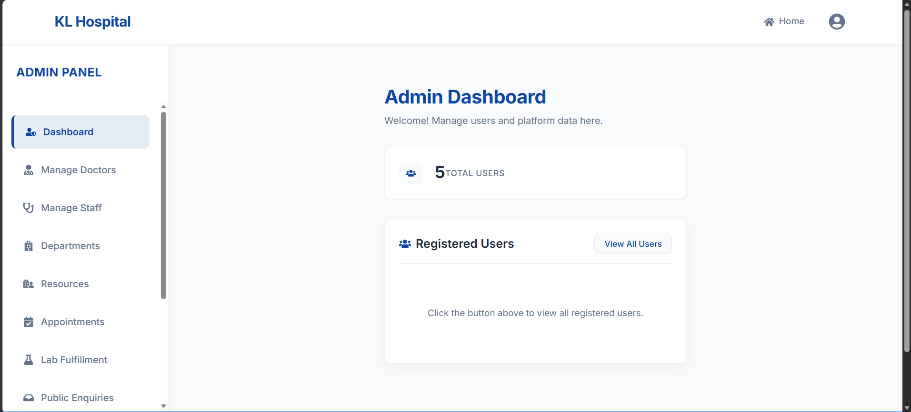
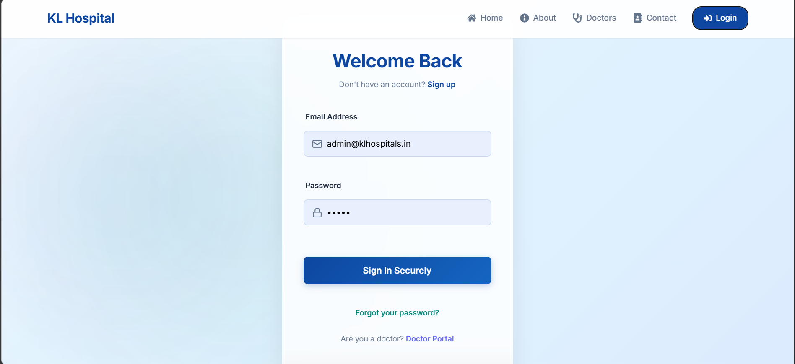
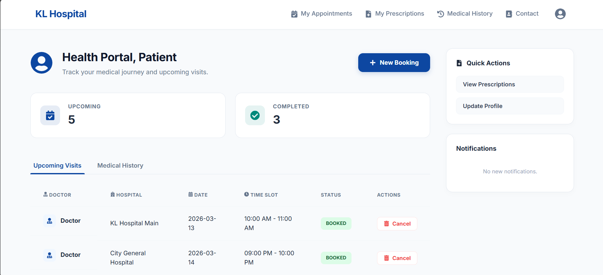
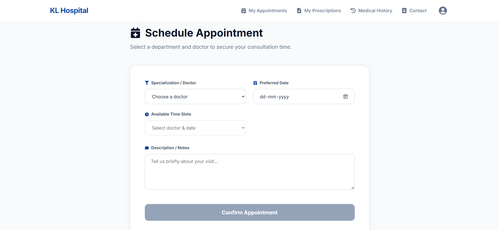
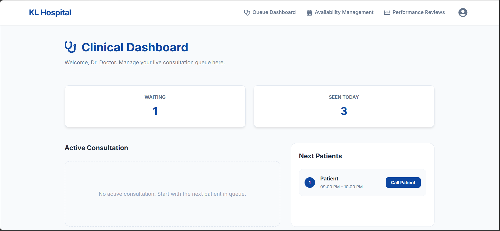
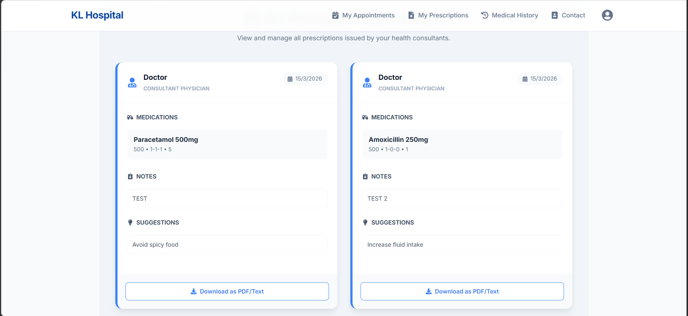
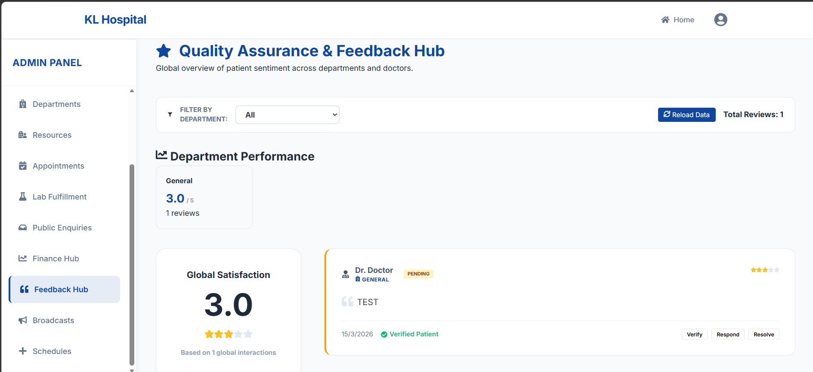

# KL Hospitals Management System

A full-stack hospital management application built with **React**, **Spring Boot**, **Spring Security**, **JWT**, and **MySQL**. It brings patient, doctor, and administrator workflows into one web application.




## Contents

- [Overview](#overview)
- [Features](#features)
- [User Roles](#user-roles)
- [Workflows](#workflows)
- [Technology Stack](#technology-stack)
- [Architecture](#architecture)
- [Security](#security)
- [Project Structure](#project-structure)
- [Prerequisites](#prerequisites)
- [Local Setup](#local-setup)
- [Environment Configuration](#environment-configuration)
- [Running the Application](#running-the-application)
- [API and Authentication](#api-and-authentication)
- [Screenshots](#screenshots)
- [Current Limitations](#current-limitations)
- [Future Improvements](#future-improvements)
- [Contributing](#contributing)
- [License](#license)
- [Author](#author)

## Overview

Hospital workflows often depend on fragmented software or manual processes. This project puts patients, doctors, and administrators on a single platform so that appointments, prescriptions, and feedback are handled in one place.

**Problems it addresses**

- Appointment scheduling conflicts (double bookings)
- Paper-based prescription handling
- Unauthorized access to patient data
- Limited visibility into hospital workflow for administrators

## Features

- **Authentication:** user registration and login endpoints, with JWT-based request authentication.
- **Role-based access control:** Spring Security rules for administrator, doctor, and patient workflows.
- **Doctor management:** doctor-related API routes with access restrictions.
- **Appointments and bookings:** booking and availability endpoints, with conflict checking so a slot cannot be booked twice.
- **Prescriptions:** prescription-related API routes.
- **Feedback:** feedback submission endpoints.
- **Frontend/backend separation:** React frontend communicating with the Spring Boot backend over REST.

## User Roles

| Role | Responsibilities |
|---|---|
| Admin | Manage doctors, departments, and hospital staff; review feedback |
| Doctor | Manage appointments, conduct consultations, issue prescriptions |
| Patient | Register, book appointments, view personal history and prescriptions |

Access to each route is enforced by Spring Security. See `SecurityConfig` for the exact rules.

## Workflows

### Appointment booking

1. The patient searches for a doctor.
2. The system checks the doctor's available slots.
3. The patient selects a slot and confirms the booking.
4. The appointment appears in the doctor's dashboard.

### Consultation

1. The doctor opens the appointment.
2. The doctor records the consultation and issues a prescription.
3. The patient can view the prescription and submit feedback.

### Conflict prevention

Before confirming a booking, the booking service checks for conflicting slots so that the same doctor and time cannot be booked twice.

## Technology Stack

| Layer | Technologies |
|---|---|
| Frontend | React, Vite, Axios, React Router |
| Backend | Java 17, Spring Boot, Spring Security, Spring Data JPA |
| Authentication | JWT request filter, BCrypt password encoder |
| Database | MySQL |
| Build | Maven Wrapper, npm |

## Architecture

```text
Browser
   |
   v
React + Vite frontend
   |
   | HTTP / REST
   v
Spring Boot backend
   |
   +-- Spring Security / JWT
   |
   v
MySQL database
```

## Security

- **JWT authentication:** a request filter validates the token on each request.
- **Role-based authorization:** routes are restricted by role in the Spring Security configuration.
- **Password hashing:** passwords are hashed with BCrypt.
- **Secrets via environment variables:** database credentials and the JWT secret are not hardcoded. `.env` files are excluded by `.gitignore`.
- **Data ownership checks:** requests for patient records, bookings, and prescriptions should be validated against the authenticated user, not only the role.

## Project Structure

```text
Hospital Management System/
├── backend/
│   ├── src/
│   │   ├── main/
│   │   └── test/
│   ├── .env.example
│   ├── mvnw
│   └── run-backend.bat
├── frontend/
│   ├── src/
│   └── package.json
├── docs/
│   └── screenshots/
└── .gitignore
```

Folder and file names may differ slightly as the project evolves.

## Prerequisites

- **Java 17** (or the version configured by the backend build)
- **Node.js and npm**
- **MySQL 8.x**
- Git

## Local Setup

### 1. Clone the repository

Replace `<repository-url>` with the URL of this repository.

```bash
git clone <repository-url>
cd <repository-folder>
```

### 2. Create the database

```sql
CREATE DATABASE hms_db;
```

Use a different name if you prefer, and update the datasource URL to match.

### 3. Configure backend environment variables

The backend reads its database, JWT, and CORS settings from environment variables. Create a local `backend/.env` file based on `backend/.env.example` and replace the placeholders with your own values.

```dotenv
SPRING_DATASOURCE_URL=jdbc:mysql://localhost:3306/hms_db
SPRING_DATASOURCE_USERNAME=your_mysql_username
SPRING_DATASOURCE_PASSWORD=your_mysql_password
JWT_SECRET=replace_with_a_long_random_secret
JWT_EXPIRATION=86400000
CORS_ALLOWED_ORIGINS=http://localhost:5173,http://localhost:5100,http://localhost:5101
```

**Never commit `.env` files, database passwords, or real JWT secrets.**

### 4. Configure the frontend

If the frontend uses `VITE_API_BASE_URL`, create `frontend/.env`:

```dotenv
VITE_API_BASE_URL=http://localhost:8086
```

Vite exposes `VITE_`-prefixed variables to browser code, so never put secrets here.

## Running the Application

### Backend

From the repository root, using the batch file (requires a configured `backend/.env`):

```powershell
.\backend\run-backend.bat
```

Or with the Maven Wrapper, after setting the environment variables in your shell:

```powershell
cd backend
.\mvnw spring-boot:run
```

The backend runs on port **8086**.

### Frontend

In a second terminal:

```powershell
cd frontend
npm install
npm run dev
```

Open the URL printed by Vite, commonly `http://localhost:5173`.

## Environment Configuration

| Variable | Purpose |
|---|---|
| `SPRING_DATASOURCE_URL` | JDBC URL for the MySQL database |
| `SPRING_DATASOURCE_USERNAME` | MySQL username |
| `SPRING_DATASOURCE_PASSWORD` | MySQL password |
| `JWT_SECRET` | Secret used to sign and validate JWTs |
| `JWT_EXPIRATION` | Token lifetime in milliseconds (`86400000` is 24 hours) |
| `CORS_ALLOWED_ORIGINS` | Comma-separated list of allowed frontend origins |
| `VITE_API_BASE_URL` | Frontend API base URL |

Use strong, unique values for secrets, and never reuse the example values in a deployed environment.

## API and Authentication

The backend exposes REST endpoints under `/api`:

| Route | Purpose |
|---|---|
| `/api/users/register` | Patient registration |
| `/api/users/login` | Patient login |
| `/api/doctors/login` | Doctor login |
| `/api/doctors/**` | Doctor-related operations |
| `/api/bookings/**` | Appointment bookings |
| `/api/availability/**` | Doctor availability |
| `/api/prescriptions/**` | Prescriptions |
| `/api/feedback/**` | Feedback |

Access requirements vary by route and HTTP method. This list is illustrative, not a full API specification. See the backend controllers and `SecurityConfig` for the current contract.

## Screenshots

### Home Page


### Login Page


### Patient Dashboard


### Appointment Booking


### Doctor Dashboard


### Medical Records


### Admin Dashboard


### Analytics Dashboard


## Current Limitations

- No payment gateway integration.
- No real-time chat or telemedicine.
- File uploads are limited.
- Production deployment configuration and monitoring need additional setup.

## Future Improvements

- Automated integration tests for authentication and role-based access.
- OpenAPI/Swagger API documentation.
- Docker-based deployment with a safe production configuration.
- Audit logging, observability, and improved error handling.
- Appointment reminders and smarter rescheduling.
- Telemedicine, once implemented and tested.

## Contributing

1. Fork the repository.
2. Create a feature branch.
3. Make and test your changes.
4. Commit with a clear message.
5. Open a pull request describing the change.

## Author

**Macharla Sainadh**
